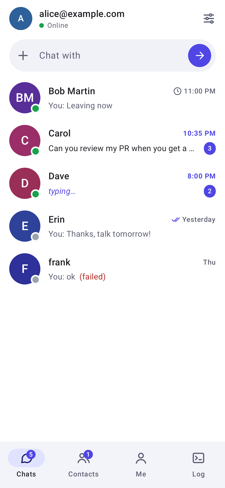
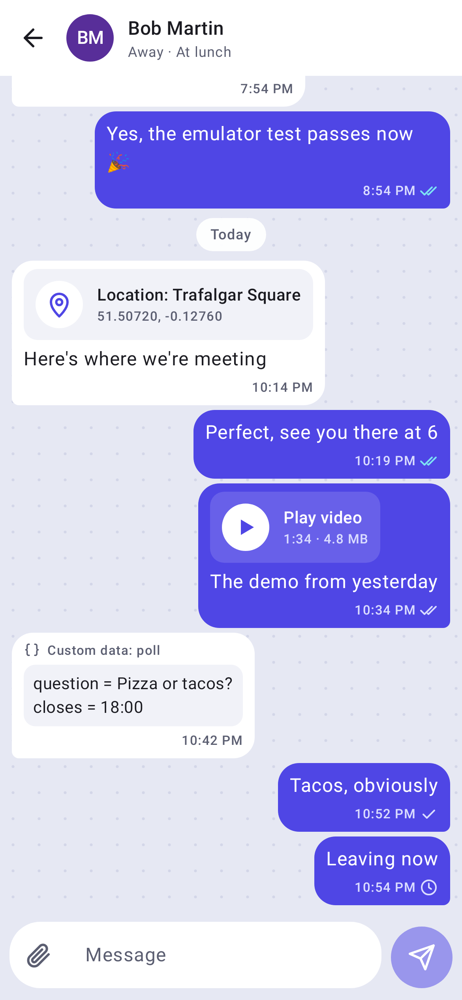
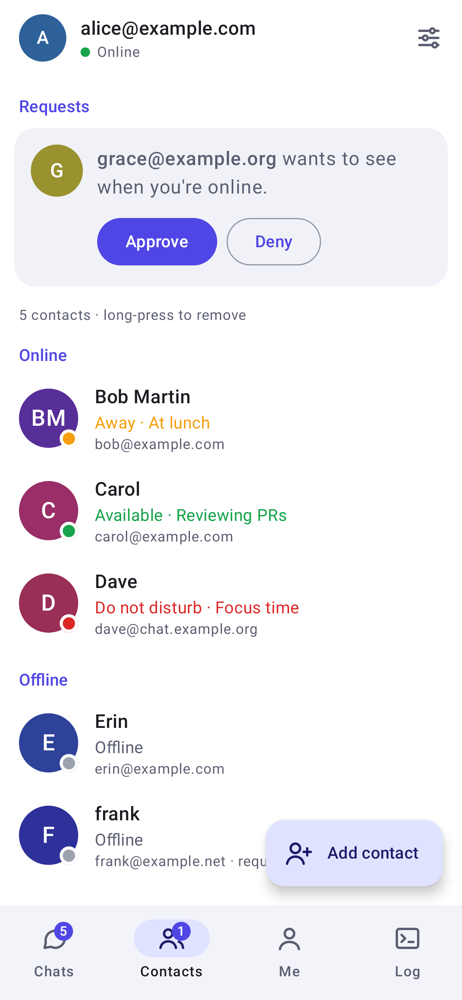
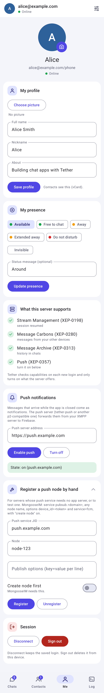
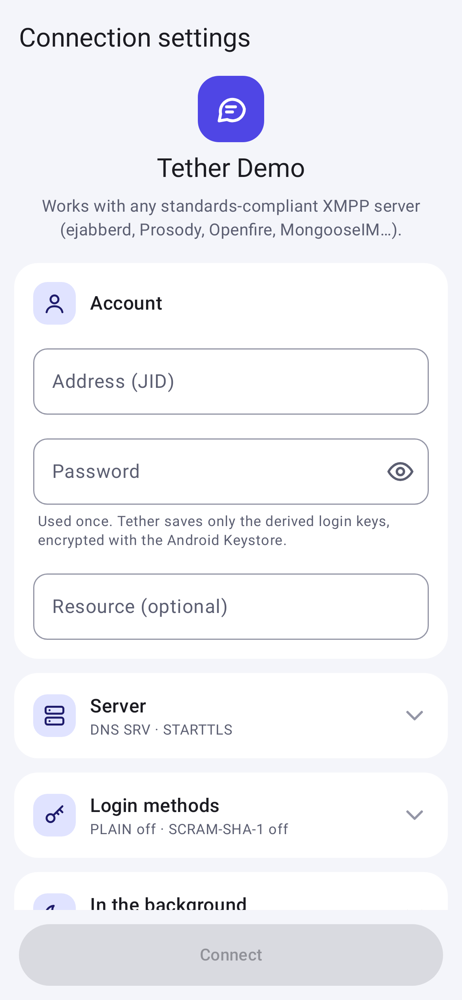

# Tether demo for Android

A small Android chat app that uses every feature of the [Tether XMPP SDK](https://github.com/usmandurrany/tether-xmpp),
for developers to read and copy from. It connects to any standards-compliant XMPP server
(ejabberd, Prosody, Openfire, MongooseIM…) through a generic connection settings page.

It is also meant as a small model of a Compose chat app: one ViewModel per screen,
stateless screens, type-safe navigation, light and dark themes, and a two-pane layout on
tablets and foldables (see [Architecture](#architecture)).

| Chats | Chat | Contacts | Me | Settings |
| --- | --- | --- | --- | --- |
|  |  |  |  |  |

| Screen | What it shows | SDK API |
| --- | --- | --- |
| Connection settings | Address, password, resource, host/port or DNS SRV, direct TLS, certificate pinning, PLAIN / SCRAM-SHA-1, background mode, log portal | `XmppConfig`, `TlsConfig`, `SaslConfig`, `ReconnectPolicy` |
| Top bar and tabs | Live connection state, retry after a fatal error; Chats, Contacts, Me and Log in a bottom bar with unread and request badges | `XmppClient.state`, `connect()` |
| Chats | Conversations with last message, time and unread count, typing, start a chat with any address | `TetherChat.conversations` |
| Chat | Ticks (clock sending, ✓ server, ✓✓ device, blue ✓✓ read), day separators, typing indicator, read markers sent while the chat is open, offline sending, archive paging, last seen, copy text and delete for everyone or for me (long-press) | `TetherChat.messages`, `send`, `typing`, `openChat`, `loadOlder`, `deleteForEveryone`, `deleteForMe` |
| Chat, + menu | Photos, videos, locations and any custom type, sent as their own tags next to the caption and drawn on the other side | `MessageData`, `send(to, text, data)`, `message.data("photo")` |
| Contacts | Roster with presence in Online and Offline sections, add/remove, approve/deny subscription requests, or accept them automatically | `Roster`, `Presences`, `ChatFeatures(autoAcceptContacts)` |
| Profiles | Your name, nickname, "about" and picture on the Me tab; contacts' pictures and names in the lists and the chat header | `TetherChat.myProfile`, `updateMyProfile`, `Contact.avatar`, `ChatFeatures(profiles)` |
| Me | Own presence and status, invisible mode, server capabilities, push notifications, disconnect / sign out | `Presences.set/hide`, `Carbons`, `registerPush`, `wakeForPush`, `CredentialVault` |
| Log | Every stanza in and out (credentials always redacted), connection events, log portal upload stats | `TetherDebug`, `MemorySink`, `RemoteLogSink` |

All SDK calls are in one file, [`TetherSession.kt`](app/src/main/kotlin/io/github/usmandurrany/tether/demo/TetherSession.kt).
The rest is plain Jetpack Compose UI with Material 3.

## Build and run

You need Android Studio (or JDK 17+ and the Android SDK with API 35). The SDK comes with
the clone: [tether-xmpp](https://github.com/usmandurrany/tether-xmpp) is a public git
submodule, so no account, token or extra download step is needed.

```sh
git clone --recursive https://github.com/usmandurrany/tether-demo-android.git
```

Then open the folder in Android Studio and press Run, or from a terminal:

```sh
./gradlew installDebug        # needs a device or emulator; or assembleDebug for the APK
```

Already cloned without `--recursive`? Run `git submodule update --init` first; the build
tells you if the SDK sources are missing.

### How the SDK is included

The SDK is not on Maven Central yet, so it is built from source:

- `tether-xmpp/` is a git submodule pinned to a known-good SDK commit.
- [`settings.gradle.kts`](settings.gradle.kts) includes it as a Gradle composite build
  (`includeBuild("tether-xmpp")`). The app depends on the usual coordinates
  (`io.github.usmandurrany.tether:tether-android`, `tether-im`, `tether-debug`) and Gradle
  substitutes the SDK's modules. There is no publish step, and edits in `tether-xmpp/`
  show up in the app on the next build.
- The SDK only builds its Android module when it finds the Android SDK, so the settings
  script copies this project's `local.properties` into `tether-xmpp/` when that has none.

To move to the latest SDK: `git submodule update --remote tether-xmpp`, then commit the new
pointer. Once the SDK is published to a Maven repository, delete the `includeBuild` lines
and the submodule, and add that repository; the dependency lines stay the same.

## Photos, videos, locations and custom data

The **+** button in a chat sends a message with the SDK's custom data: the caption in the body, and the details as separate tags, such as a photo's link, size in bytes and dimensions. The other side reads them back with `message.data("photo")` and draws the photo, a video link or a map link. **Custom data** sends any type with any keys and values, and the receiver shows exactly what arrived. The types are in [`Attachments.kt`](app/src/main/kotlin/io/github/usmandurrany/tether/demo/Attachments.kt).

The demo has no file hosting, so photos and videos are links to files already online; it reads their size from the web server before sending.

Settings has three chat switches: **Accept contact requests automatically** (`ChatFeatures(autoAcceptContacts = true)`, off by default as in the SDK), **Keep chats on this device** (the SDK's `SqliteMessageStore`, on by default) and **Profiles and pictures** (`ChatFeatures(profiles)`, vCard, on by default). A picked picture is cropped square and made a 192×192 JPEG so it fits in one stanza. Signing out deletes the stored chats.

## Connecting

Fill in the settings page and press **Connect**:

- **Address**: your full JID, `alice@example.com`.
- **Password**: used for the first login only. Tether keeps the derived SCRAM keys in
  Android Keystore-encrypted storage, so later logins (and **Connect on app start**) need
  no password. **Sign out** on the Me tab deletes them.
- **Host / Port**: leave empty to find the server through the DNS SRV records of the
  domain. Set a host (name or IP) to connect directly, for example to a server on your LAN.
  From the Android emulator, your computer is `10.0.2.2`.
- **Direct TLS**: for servers that speak TLS from the first byte (usually 5223).
  STARTTLS is the default. Tether never connects without TLS.
- **Trusted certificate fingerprints**: for self-signed servers. If the certificate is
  refused, the app shows its SHA-256 fingerprint and offers to trust exactly that
  certificate. Compare it with the server's (`./gradlew :tools:probe:run` in the SDK
  prints it) before accepting.
- **Allow PLAIN / SCRAM-SHA-1**: off by default; turn on only for servers that need them.
- **In the background**: what happens five seconds after the app leaves the screen.
  *Disconnect* lets the server store messages and send push notifications; *Detach* keeps
  the session resumable for a fast return; *Stay connected* keeps the socket open and
  marks the client inactive (CSI).

A quick test: sign in with two accounts on two devices (or a device and any desktop XMPP
client), add each other on the Contacts tab, approve the request, and chat.

Server features show up only when the server offers them (Me tab → *What this server
supports*). History needs `mod_mam` (ejabberd, MongooseIM, Prosody) or Openfire's
Monitoring plugin; without it, chats show messages from this run plus offline messages.

## Push notifications

Messages that arrive while the app is closed show up as notifications. This takes three
pieces, and only the last is in this repo:

1. **A Firebase project.** In the [Firebase console](https://console.firebase.google.com),
   add an Android app with the package `io.github.usmandurrany.tether.demo`, download its
   `google-services.json` and put it at `app/google-services.json`. Git ignores that file.
   Without it the app builds and runs as before, with push off.
2. **A push server** holding that project's credentials:
   [tether-push](https://github.com/usmandurrany/tether-push), deployed to Cloud Run in the
   same Firebase project or anywhere else. It logs in as its own XMPP account, for example
   `myapp-push@sure.im`, and its address is that account plus `/push`.
3. **The app.** On the Me tab, enter the push server's address and press **Enable push**. The
   app asks for permission to notify (Android 13+), registers its FCM token with the push
   server, and then registers with your XMPP server again on every login. Keep the background
   mode on **Disconnect** (Settings), so the server sees you offline and pushes.

When a push arrives, [`DemoPushService`](app/src/main/kotlin/io/github/usmandurrany/tether/demo/Push.kt)
calls `chat.wakeForPush()`, also when the push started the app. The SDK connects, the waiting
messages arrive, and `MessageNotifier` shows one notification per chat. The connection closes
again 30 s later if the app is still in the background. The SDK calls are in
[`TetherSession.kt`](app/src/main/kotlin/io/github/usmandurrany/tether/demo/TetherSession.kt):

```kotlin
chat.registerPush(PushAppServer.p2("myapp-push@sure.im/push", fcmToken, installId))  // Enable push
chat.wakeForPush()                                                                      // FCM message arrived
```

Your XMPP server needs XEP-0357 (sure.im, Prosody, ejabberd and Openfire have it). For
MongooseIM, whose own push service takes the token directly, **Register a push node by hand**
on the Me tab takes any target: service `pubsub.<domain>`, any node name, options
`device_id=<token>` and `service=fcm`, with "create node" on.

## Debug logs

The Log tab shows the SDK's traffic, also written to Logcat under the tag `Tether`.
To collect logs from testers, run a [tether-debug](https://github.com/usmandurrany/tether-debug)
portal and fill in its URL and ingest key in the settings. Uploads are batched every two
seconds and flushed when the app goes to the background. Debug builds allow plain `http://`
for a portal on your LAN; release builds need `https://`. Turn on **Hide message text in
logs** for testing rounds with people outside your team.

## Architecture

The app follows the [Android architecture guide](https://developer.android.com/topic/architecture)
without extra libraries: no DI framework, no image loader, no icon pack.

- **One ViewModel per screen** turns the SDK's flows into one immutable `UiState`
  (`StateFlow`, collected with `collectAsStateWithLifecycle`). Screens are stateless
  composables, `XScreen(state, actions)`, with a small `XRoute` that wires the ViewModel in.
  That is what the previews and screenshot tests render.
- **Unidirectional data flow**: the SDK is the source of truth for chats, contacts and
  presence; the UI only sends events back (send, delete, add contact).
- **Saved state**: form drafts (settings, profile, presence, push) live in a
  `SavedStateHandle`, so they survive rotation and process death. The password does not,
  on purpose.
- **Navigation Compose** with type-safe `@Serializable` routes. Navigation follows the
  session: no session shows the sign-in page, signing in opens the tabs, and a message
  notification opens its chat.
- **Adaptive layout**: on windows 720 dp or wider, Chats shows the open chat beside the list.
- **Theme**: an indigo Material 3 colour scheme for light and dark, plus chat colours
  (bubbles, wallpaper, ticks, presence) in a `CompositionLocal`. The icons are drawn as
  small `ImageVector`s in [`Icons.kt`](app/src/main/kotlin/io/github/usmandurrany/tether/demo/ui/theme/Icons.kt).
- **Strings** are all in [`strings.xml`](app/src/main/res/values/strings.xml), ready to translate.

```
app/src/main/kotlin/io/github/usmandurrany/tether/demo/
  TetherSession.kt        everything that talks to the SDK
  DemoApp.kt              one session per process, sign-in and sign-out
  ConnectionSettings.kt   the settings model and where it is saved
  MainActivity.kt         the only activity: theme and navigation
  ui/navigation/          routes and the NavHost
  ui/signin/              connection settings page and its ViewModel
  ui/home/                top bar, bottom tabs, two-pane layout
  ui/chats/  ui/chat/     chat list, one chat, attach and message sheets
  ui/contacts/  ui/me/  ui/log/
  ui/components/          avatars, media, presence, times, form building blocks
  ui/theme/               colours, chat colours, icons
```

With **Keep chats on this device** on, messages are kept in the SDK's SQLite store; with
it off they are kept in memory and refilled from the server archive after a restart.

## Screenshots

[`ScreenshotTest`](app/src/test/kotlin/io/github/usmandurrany/tether/demo/ScreenshotTest.kt)
renders every screen with sample data on the JVM (Robolectric and Roborazzi), with no device:

```sh
./gradlew testDebugUnitTest   # PNGs in app/build/screenshots
```

## End-to-end test

[`ChatEndToEndTest`](app/src/androidTest/kotlin/io/github/usmandurrany/tether/demo/ChatEndToEndTest.kt)
drives the real UI against a real server: it signs in as `alice` on the settings page, trusts
the server's self-signed certificate when asked, opens a chat with `bob` (a second SDK
session), waits for the two delivery ticks, and checks bob's reply shows up. To run it
against a throwaway ejabberd and an emulator:

```sh
docker run -d --name ejabberd -p 5222:5222 ghcr.io/processone/ejabberd
docker exec ejabberd ejabberdctl register alice localhost secret
docker exec ejabberd ejabberdctl register bob localhost secret
./gradlew connectedDebugAndroidTest \
  -Pandroid.testInstrumentationRunnerArguments.xmppHost=10.0.2.2 \
  -Pandroid.testInstrumentationRunnerArguments.xmppDomain=localhost \
  -Pandroid.testInstrumentationRunnerArguments.xmppPassword=secret
```

Without those arguments the test is skipped. [`scripts/e2e-emulator.sh`](scripts/e2e-emulator.sh)
does all of this against a running emulator, as CI does.

## CI

[`build.yml`](.github/workflows/build.yml) runs on every push and pull request: it builds
the debug APK with the SDK from the submodule, runs lint, then runs the end-to-end test on an
emulator against ejabberd. The APK is uploaded as the `tether-demo-debug-apk` artifact, ready
to install. A third job renders the screenshots; run the workflow by hand
(**Actions → Build → Run workflow**) to commit fresh ones to `docs/screenshots`.

## License

Apache 2.0, like the SDK.
